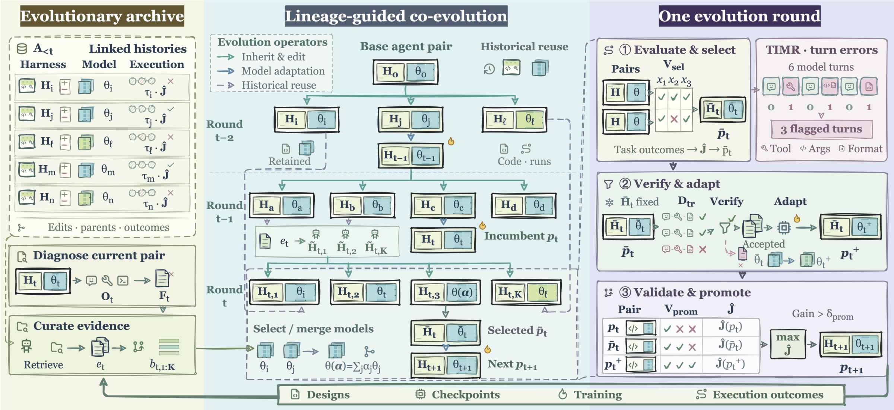
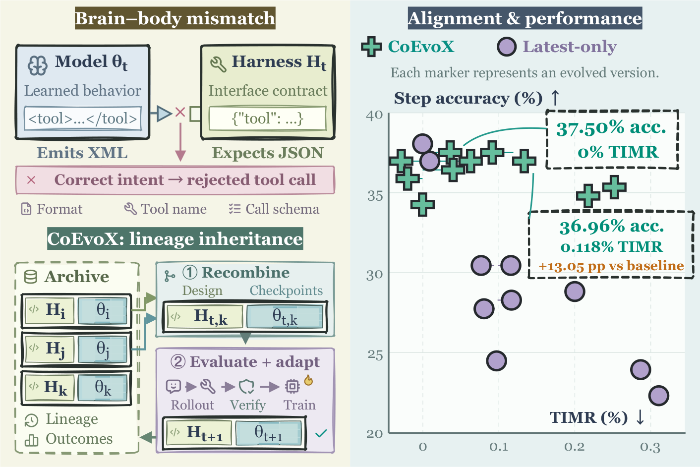
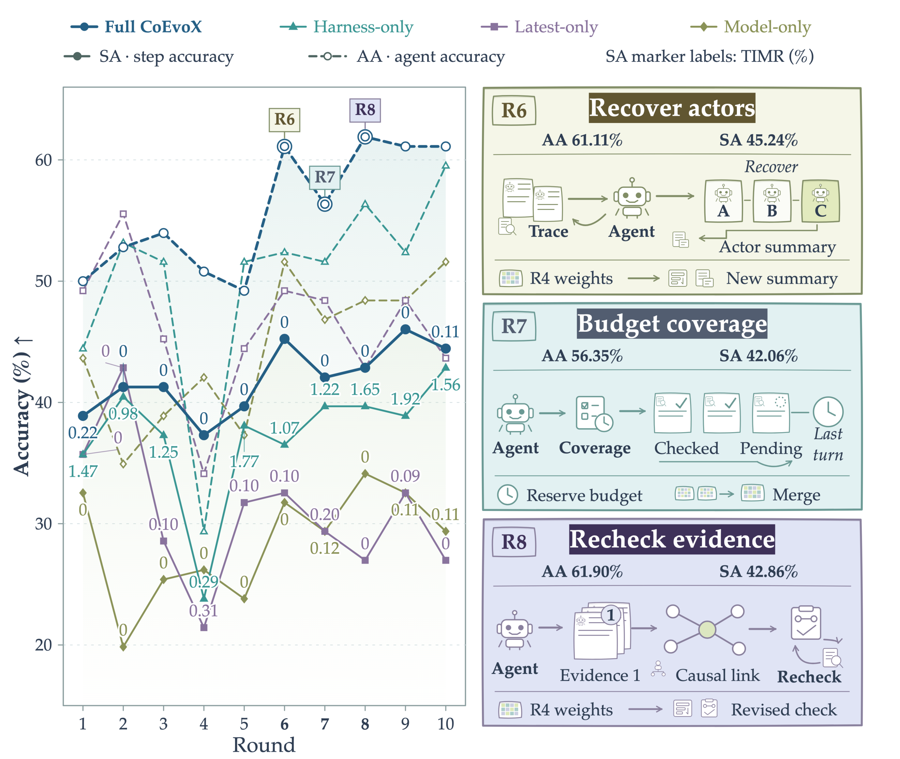

<div align="center">

# CoEvoX: When Harnesses Evolve, Which Models Should Follow?

[](https://arxiv.org/abs/2610.25078)
[](https://huggingface.co/collections/nullptr04/coevo-rsi)

</div>

## Introduction



**CoEvoX** is a framework for **model–harness co-evolution** of LLM agents. It addresses the **brain–body mismatch problem**: an evolving harness (the body) can demand behaviors that its model (the brain) has not learned. It can also restrict capabilities that the model already has.

CoEvoX tackles this with **bidirectional historical inheritance** over a shared evolutionary archive of past harnesses, checkpoints, and execution outcomes. Each round, a meta-agent performs three steps:

1. **Harness editing.** Editors build new harnesses from historical designs they select from the archive.
2. **Model inheritance.** For each new harness, the meta-agent selects or merges checkpoints from the archive.
3. **Adaptation and promotion.** The best model–harness pair is adapted with SFT on its own rejection-sampled trajectories, and only validated improvements are promoted.

To diagnose interface mismatch, we introduce **TIMR** (Turn-level Interface Mismatch Rate). With this procedure, **Qwen3.5-9B** becomes competitive with much larger models on three domains:

- multi-agent failure attribution;
- role-aware text-to-SQL;
- smart-home instruction following.

<p align="center">
  
</p>

## Main Results

**Failure attribution** (agent / step accuracy, %). The test benchmarks are held out from both training and evolutionary selection.

| System | W&W Hand Who | W&W Hand When | W&W Algo. Who | W&W Algo. When | W&W Pro Who | W&W Pro When | TraceElephant Who | TraceElephant When |
| --- | --: | --: | --: | --: | --: | --: | --: | --: |
| DeepSeek-V4-Pro-0813 | 60.34 | 10.34 | 65.87 | 22.22 | 61.77 | 70.40 | 56.62 | 31.96 |
| Qwen3.8-Max | 50.00 | 12.07 | 64.29 | 11.11 | 65.03 | **72.40** | 47.03 | 32.42 |
| FALAT + MiniMax-2.5 | 66.30 | 25.90 | **68.00** | **46.00** | – | – | – | – |
| Self-Harness | 56.90 | 24.14 | 56.35 | 38.89 | 47.94 | 54.11 | 49.77 | 7.76 |
| GSPO | 44.83 | 20.69 | 57.94 | 42.86 | 62.00 | 63.43 | 47.03 | **38.36** |
| Qwen3.5-9B | 37.93 | 15.52 | 50.00 | 31.75 | 57.20 | 49.66 | 25.57 | 4.11 |
| **CoEvoX (Qwen3.5-9B)** | **68.39** | **29.31** | 62.17 | 44.71 | **69.43** | 57.39 | **70.78** | 28.92 |

**Role-aware text-to-SQL** (RBAC, %). BIRD is out-of-distribution and is never used for training. For Viol., lower is better.

| System | Spider Safe-EX | Spider AC-F1 | Spider Safe-Deny | Spider Viol.↓ | BIRD Safe-EX | BIRD AC-F1 | BIRD Safe-Deny | BIRD Viol.↓ |
| --- | --: | --: | --: | --: | --: | --: | --: | --: |
| DeepSeek-V4-Pro-0813 | 78.33 | 94.90 | 95.65 | 2.04 | 64.16 | **90.39** | 90.35 | 7.00 |
| OpenCode + DeepSeek-V4.1-Flash | 79.58 | 95.52 | 94.85 | 2.41 | **74.86** | 83.06 | 84.04 | 5.90 |
| Pi + MiniMax-M3 | 80.26 | **95.85** | 96.33 | 1.72 | 70.81 | 86.80 | 88.60 | 8.70 |
| Qwen3.5-9B | 76.91 | 94.72 | 92.95 | 3.41 | 53.52 | 87.00 | 85.54 | 9.25 |
| **CoEvoX (Qwen3.5-9B)** | **80.85** | 95.51 | **96.64** | **1.57** | 60.15 | 90.24 | **91.26** | **5.65** |

**Smart-home instruction following** (HomeBench multi-device, %). VM denotes valid instructions and IM denotes invalid ones.

| System | VM Succ. | VM F1 | IM Succ. | IM F1 |
| --- | --: | --: | --: | --: |
| DeepSeek-V4-Pro-0813 | 75.10 | 89.18 | 83.51 | 90.83 |
| GLM-5.3 | 70.61 | 86.65 | 64.95 | 81.42 |
| Qwen3.8-Max | 53.88 | 79.26 | **84.54** | 91.24 |
| Qwen3.5-9B | 10.61 | 40.15 | 62.89 | 78.71 |
| **CoEvoX (Qwen3.5-9B)** | **75.51** | **89.23** | **84.54** | **91.80** |

The paper contains the full baseline tables and the ablation, cost, and inheritance analyses. The figure below shows ten rounds of co-evolution on Who&When Algo. Agent and step accuracy rise while TIMR stays at or below 0.22%.

<p align="center">
  
</p>

## Repository Structure

```text
CoEvoX/
|-- src/
|   |-- meta_evolver/      # co-evolution loop: archive, Curator/Editors, model inheritance, promotion
|   |-- domains/           # task plugins: who_when/, rbac/, homebench/
|   |-- training/          # rejection sampling and full-parameter SFT (ms-swift)
|   |-- diagnostics/       # TIMR / interface-mismatch statistics
|   |-- runner/            # model client, vLLM lifecycle, pair evaluation
|   `-- traces/, utils/
|-- harnesses/             # initial and final evolved harness per domain
|-- configs/               # base.yaml, who_when/rbac/homebench.yaml, rbac_environment.yaml
|-- scripts/               # co-evolution and pair-evaluation entry points
|-- docs/                  # per-domain task and harness design (who_when, rbac, homebench)
|-- assets/                # figures
|-- ms-swift/              # training framework (cloned during setup)
`-- tests/
```

## Setup

```bash
cd CoEvoX
git clone https://github.com/modelscope/ms-swift.git ms-swift
git -C ms-swift checkout 1a7977b7f36025b0bb7528ec121cd3feac3032e3

conda create -n coevox python=3.10 -y
conda activate coevox
python -m pip install -e '.[train,dev]'
python -m pip install -e ms-swift
cp .env.example .env

# RBAC task execution and SQL evaluation run in a separate environment
conda env create --prefix .venvs/rbac --file configs/rbac_environment.yaml
```

Fill in the following variables in `.env`:

- the meta-agent endpoint (`OPENAI_BASE_URL`, `OPENAI_API_KEY`);
- the task-model endpoint (`POLICY_BASE_URL`);
- `MODEL_PATH`, which points to your local Qwen3.5-9B weights.

The meta-agent runs through the Codex CLI, which must be available on `PATH`.

Place the datasets under `data/`, following the paths in `configs/{who_when,rbac,homebench}.yaml`. The supported datasets are Who&When, Who&When Pro, TraceElephant, RBAC-Text2SQL (Spider and BIRD), and HomeBench.

## Evaluating the Released Checkpoints

We release the final co-evolved model for each domain in the [Hugging Face collection](https://huggingface.co/collections/nullptr04/coevo-rsi). Each one is Qwen3.5-9B after full-parameter SFT. Each model is paired with the final evolved harness of its domain, `harnesses/<domain>/generated/`. The same harness is also copied into the `harness/` folder of each Hugging Face repo. **Always evaluate a released checkpoint with the `generated` harness.**

| Domain | Checkpoint | Harness | Evaluation script |
| --- | --- | --- | --- |
| Failure attribution | [`nullptr04/CoEvo-RSI-who-when`](https://huggingface.co/nullptr04/CoEvo-RSI-who-when) | `harnesses/who_when/generated` | `scripts/run_whowhen_full_test.sh` |
| Role-aware text-to-SQL | [`nullptr04/CoEvo-RSI-rbac`](https://huggingface.co/nullptr04/CoEvo-RSI-rbac) | `harnesses/rbac/generated` | `scripts/run_rbac_full_test.sh` |
| Smart-home instructions | [`nullptr04/CoEvo-RSI-homebench`](https://huggingface.co/nullptr04/CoEvo-RSI-homebench) | `harnesses/homebench/generated` | `scripts/run_homebench_full_test.sh` |

To evaluate a checkpoint, you need the [Setup](#setup) steps above, the datasets under `data/`, and, for RBAC, the `.venvs/rbac` environment. You do not need the meta-agent endpoint or the Codex CLI.

**1. Download and serve the checkpoint.** Use the same vLLM flags as co-evolution (`configs/base.yaml`). The tool-call and reasoning parsers are required, because the harnesses talk to the model through tool calls.

```bash
DOMAIN_CKPT=who-when   # or: rbac, homebench
huggingface-cli download nullptr04/CoEvo-RSI-${DOMAIN_CKPT} --local-dir ckpts/CoEvo-RSI-${DOMAIN_CKPT}

CUDA_VISIBLE_DEVICES=0 vllm serve ckpts/CoEvo-RSI-${DOMAIN_CKPT} \
  --host 127.0.0.1 --port 8000 \
  --served-model-name CoEvo-RSI-${DOMAIN_CKPT} \
  --max-model-len 65536 \
  --enable-auto-tool-choice --tool-call-parser qwen3_coder \
  --reasoning-parser qwen3
# With more GPUs, add e.g. --data-parallel-size 4 and list the GPUs in CUDA_VISIBLE_DEVICES.
```

**2. Run the evaluation in another shell.** The scripts read the model from `POLICY_BASE_URL` (default `http://127.0.0.1:8000/v1`) and detect the served model ID automatically. Each script runs one test split. To run another split, set `TEST_DATA`. Also give every split its own `OUTPUT_ROOT`: the scripts resume from existing predictions, so two splits that share an output directory would be mixed.

```bash
# Failure attribution: Who&When (Hand-Crafted + Algorithm-Generated), Who&When Pro, TraceElephant
bash scripts/run_whowhen_full_test.sh generated
TEST_DATA=data/whowhen/test_whowhen_pro.jsonl   OUTPUT_ROOT=output/who_when/full_test_pro \
  bash scripts/run_whowhen_full_test.sh generated
TEST_DATA=data/whowhen/test_traceelephant.jsonl OUTPUT_ROOT=output/who_when/full_test_traceelephant \
  bash scripts/run_whowhen_full_test.sh generated

# Role-aware text-to-SQL: Spider (in-distribution) and BIRD (out-of-distribution)
bash scripts/run_rbac_full_test.sh generated
TEST_DATA=data/rbac/bird.jsonl OUTPUT_ROOT=output/rbac/full_test_bird \
  bash scripts/run_rbac_full_test.sh generated

# Smart-home instruction following: HomeBench
bash scripts/run_homebench_full_test.sh generated
```

**3. Read the results.** Each run writes `samples.jsonl` and `metrics.json` to `<OUTPUT_ROOT>/generated/`. The metrics correspond to the [Main Results](#main-results) tables as follows:

- **Who&When:** agent and step accuracy, overall and per benchmark split under `by_split` (e.g. Hand-Crafted and Algorithm-Generated).
- **RBAC:** Safe-EX, AC-F1, Safe-Deny, and violation rate. The script also prints them as a `RESULT` line.
- **HomeBench:** overall EM and F1, plus `per_type` scores. The `VM` and `IM` entries are the valid and invalid multi-device instructions.

For the BIRD split, the SQLite databases are found automatically under `data/RBAC-Text2SQL-Benchmark-official/data/Bird/dev_20251106/dev_databases/`.

## Co-Evolution

```bash
# Dry run (no GPU, weights, or API calls)
ROUNDS=1 bash scripts/run.sh --dry-run

# Run co-evolution for one domain
CUDA_VISIBLE_DEVICES=0,1,2,3 bash scripts/run_whowhen.sh
CUDA_VISIBLE_DEVICES=0,1,2,3 bash scripts/run_rbac.sh
CUDA_VISIBLE_DEVICES=0,1,2,3 bash scripts/run_homebench.sh

# Resume a round
bash scripts/run.sh --domain who_when --resume <round_id>
```

Harness and model inheritance are configured independently in `configs/base.yaml`. Each side is set to either `agent` (the meta-agent decides) or `predefined` (fixed rules).

## Evaluating a Model–Harness Pair

```bash
# Evaluate the pair promoted in a round of your own co-evolution run (vLLM is managed automatically)
CUDA_VISIBLE_DEVICES=0,1,2,3 bash scripts/run_evolved_full_test.sh <round_id>

# Evaluate a model already served at POLICY_BASE_URL with a harness (initial_harness or generated)
bash scripts/run_whowhen_full_test.sh   generated
bash scripts/run_rbac_full_test.sh      generated
bash scripts/run_homebench_full_test.sh generated
```

Each domain ships two harnesses under `harnesses/<domain>/`: `initial_harness/` and the final evolved harness `generated/` (the default `harness.active` in each config). Candidates from new co-evolution runs are written to `candidates/`. Results are written to `output/<domain>/full_test/`. Each evaluation also reports TIMR in `mismatch.json`.

## Acknowledgments

This repo builds on **[ms-swift](https://github.com/modelscope/ms-swift)** for supervised fine-tuning and **[vLLM](https://github.com/vllm-project/vllm)** for model serving.
